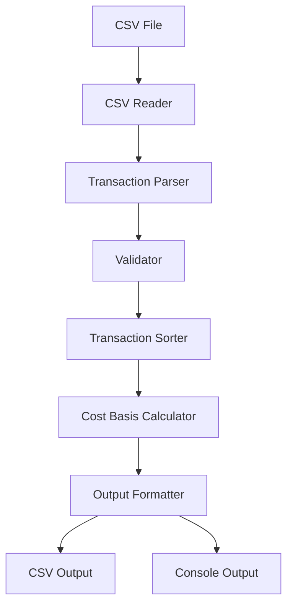

# Design Document

## Overview

米国株の取得費計算システムは、CSV形式の取引履歴を読み込み、日本の税法に基づく総平均法で各売却時点の取得費を計算する。システムはPython 3.14で実装し、標準ライブラリを中心に構成する。

## Architecture



システムは以下のパイプライン構造で処理を行う：
1. CSVファイルの読み込み
2. トランザクションデータのパース
3. データ検証
4. 日付順ソート
5. 取得費計算
6. 結果出力

## Components and Interfaces

### Transaction データクラス

```python
@dataclass
class Transaction:
    transaction_date: date
    transaction_type: Literal["buy", "sell"]
    exchange_rate: Decimal
    unit: int
    unit_price: Decimal
    
    @property
    def amount_jpy(self) -> Decimal:
        """円建て金額を計算"""
        return self.unit_price * self.unit * self.exchange_rate
```

### CostBasisResult データクラス

```python
@dataclass
class CostBasisResult:
    transaction_date: date
    shares_sold: int
    average_cost_per_share: int  # 円（1円未満切り上げ済み）
    total_cost_basis: int  # 円
```

### CSVReader クラス

```python
class CSVReader:
    def read(self, file_path: Path) -> list[dict[str, str]]:
        """CSVファイルを読み込み、辞書のリストを返す"""
        pass
```

### TransactionParser クラス

```python
class TransactionParser:
    def parse(self, raw_data: list[dict[str, str]]) -> list[Transaction]:
        """生データをTransactionオブジェクトに変換"""
        pass
```

### Validator クラス

```python
class Validator:
    def validate(self, transactions: list[Transaction]) -> list[str]:
        """トランザクションを検証し、エラーメッセージのリストを返す"""
        pass
```

### CostBasisCalculator クラス

```python
class CostBasisCalculator:
    def calculate(self, transactions: list[Transaction]) -> list[CostBasisResult]:
        """総平均法で取得費を計算"""
        pass
```

### OutputFormatter クラス

```python
class OutputFormatter:
    def to_csv(self, results: list[CostBasisResult], output_path: Path) -> None:
        """結果をCSVファイルに出力"""
        pass
    
    def to_console(self, results: list[CostBasisResult]) -> None:
        """結果を標準出力に出力"""
        pass
```

## Data Models

### 入力CSV形式

| フィールド | 型 | 説明 | 例 |
|-----------|-----|------|-----|
| transaction_date | string | 取引日（YYYYMMDD） | 20240115 |
| transaction | string | 取引種別（buy/sell） | buy |
| exchange_rate | string | 為替レート（円/ドル） | 150.50 |
| unit | string | 株数 | 100 |
| unit_price | string | 1株あたり価格（USD） | 150.25 |

### 出力CSV形式

| フィールド | 型 | 説明 |
|-----------|-----|------|
| transaction_date | string | 売却日（YYYY-MM-DD） |
| shares_sold | int | 売却株数 |
| average_cost_per_share | int | 1株あたり取得単価（円） |
| total_cost_basis | int | 取得費合計（円） |

### 内部状態

計算中は以下の状態を保持する：
- `total_cost_jpy`: 保有株式の取得価額総額（円）
- `total_shares`: 保有株数

## Correctness Properties

*正当性プロパティは、システムのすべての有効な実行において真であるべき特性や振る舞いを定義する。プロパティは人間が読める仕様と機械で検証可能な正当性保証の橋渡しとなる。*

### Property 1: 株数整合性

*For any* 取引履歴において、任意の時点での保有株数は、その時点までの購入株数の合計から売却株数の合計を引いた値と等しくなければならない。

**Validates: Requirements 3.5**

### Property 2: 1円未満切り上げの正確性

*For any* 正の小数値 x に対して、切り上げ関数の結果 result は以下を満たす：
- result >= x
- result < x + 1
- result は整数

**Validates: Requirements 3.3**

### Property 3: 取得費計算の整合性

*For any* 売却取引において、取得費は「1株あたり取得単価（切り上げ済み） × 売却株数」と等しくなければならない。

**Validates: Requirements 3.4**

### Property 4: 円建て金額計算の正確性

*For any* 購入取引において、円建て金額は「unit_price × unit × exchange_rate」と等しくなければならない。

**Validates: Requirements 4.1, 4.2**

### Property 5: ソート順序の保証

*For any* 処理後の取引リストにおいて：
- 各取引は前の取引と同日か、それより後の日付である
- 同日の取引では、買い取引が売り取引より先に処理される

**Validates: Requirements 6.1, 6.2**

### Property 6: 出力完全性

*For any* 売却取引に対する出力結果は、transaction_date、shares_sold、average_cost_per_share、total_cost_basis の全フィールドを含まなければならない。

**Validates: Requirements 5.1, 5.2**

## Error Handling

### エラー種別

1. **FileNotFoundError**: CSVファイルが存在しない
2. **ValidationError**: データ形式が不正
   - 日付形式エラー
   - 取引種別エラー
   - 数値形式エラー
   - 必須フィールド欠落
3. **CalculationError**: 計算エラー
   - 保有株数を超える売却
   - 保有株数がゼロの状態での売却

### エラーメッセージ形式

```
[ERROR] {エラー種別}: {詳細メッセージ}
例: [ERROR] ValidationError: Row 3: Invalid date format '2024-1-15', expected YYYYMMDD
```

## Testing Strategy

### 単体テスト

- 各コンポーネントの個別テスト
- エッジケース（空ファイル、単一取引、大量取引）
- エラーケース（不正データ、ファイル不在）

### プロパティベーステスト

Hypothesisライブラリを使用して、以下のプロパティをテストする：

1. **Property 1: 株数整合性** - ランダムな取引履歴に対して、任意時点の保有株数が購入合計-売却合計と等しいことを検証
2. **Property 2: 切り上げ正確性** - ランダムな正の小数に対して、切り上げ結果が result >= x かつ result < x + 1 かつ整数であることを検証
3. **Property 3: 取得費計算整合性** - ランダムな売却取引に対して、取得費 = 単価 × 株数が成立することを検証
4. **Property 4: 円建て金額計算** - ランダムな購入取引に対して、円建て金額 = unit_price × unit × exchange_rate が成立することを検証
5. **Property 5: ソート順序** - ランダムな取引リストに対して、ソート後の日付順序と同日買い優先が正しいことを検証
6. **Property 6: 出力完全性** - ランダムな売却結果に対して、必須フィールドがすべて含まれることを検証

### テスト設定

- 各プロパティテストは最低100回のイテレーション
- テストにはプロパティ番号と要件参照をタグ付け
- タグ形式: **Feature: stock-cost-basis-calculator, Property {number}: {property_text}**
